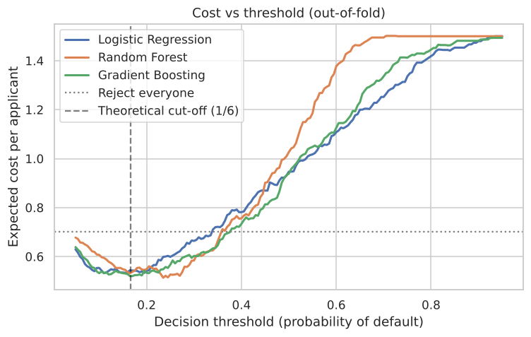
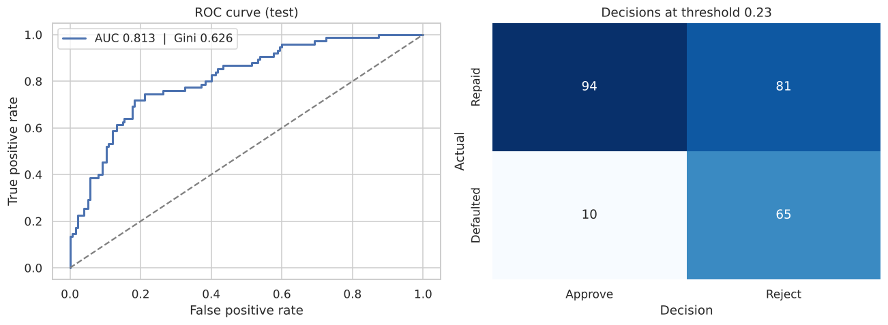
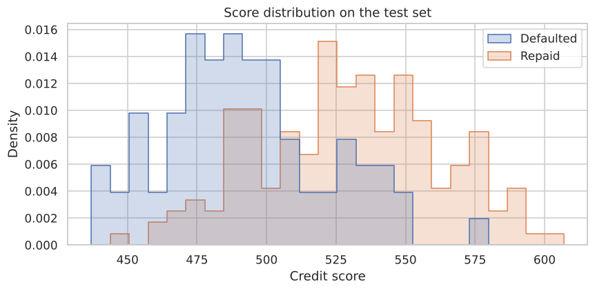

# Credit Risk Scoring

Estimating the probability that a loan applicant will default, choosing an approve/reject cut-off that minimises the bank's expected cost, and turning the model into a points-based scorecard.



## The problem

Approving a bad borrower costs a lot more than turning away a good one. The German Credit dataset formalises this with a cost matrix: **approving a defaulter costs 5, rejecting a good applicant costs 1**. So the goal isn't the highest accuracy. It's the lowest expected cost per applicant.

1,000 applicants, 20 features (checking account status, credit history, loan amount and duration, savings, employment, etc.), 30% defaults.

## What I did

1. **EDA:** default rates by account status, credit history and savings, plus how loan size, duration and age relate to risk.
2. **Feature engineering:** monthly repayment burden, amount relative to age, young-applicant flag.
3. **Compared Logistic Regression, Random Forest and Gradient Boosting** using out-of-fold predictions averaged over 3 different CV shuffles. That matters on a dataset this small, where a single split is noisy.
4. **Searched for the cost-minimising threshold** for each model, instead of using 0.5.
5. **Checked calibration**, since the decision depends on the probability values themselves.
6. **Built a scorecard:** refit logistic regression on binned features and scaled it to points (600 points = 50:1 odds, 20 points to double the odds).

## Results

| Model (out-of-fold) | ROC-AUC | Best threshold | Cost / applicant | Cost at 0.5 |
|---|---|---|---|---|
| **Random Forest** | 0.791 | 0.235 | **0.513** | 1.027 |
| Gradient Boosting | 0.792 | 0.165 | 0.520 | 0.939 |
| Logistic Regression | 0.775 | 0.110 | 0.532 | 0.947 |
| *Reject everyone* | | | *0.700* | |

**On the test set (250 applicants):**
- ROC-AUC **0.813**, Gini 0.63, KS 0.54
- Expected cost **0.524 per applicant**, vs 0.956 with the default 0.5 threshold and 0.700 for rejecting everyone
- Catches **87% of defaulters** (65/75) while still approving more than half of the good applicants



**The main finding:** at the default 0.5 threshold, every model was *worse than rejecting everyone*. Tuning the threshold to the real cost ratio roughly halved the cost. It mattered far more than the choice of algorithm, and the cost-optimal thresholds (0.11-0.24) landed close to the theoretical 1/(1+5) ≈ 0.17.

### Scorecard

The points scorecard reaches a test ROC-AUC of **0.80**, almost the same as the full model, but a loan officer can add it up by hand and every point traces back to one attribute. The full card is in `results/scorecard.csv`.



## Run it

```bash
pip install -r requirements.txt
jupyter notebook credit_risk.ipynb
```

## Data

German Credit data (Hofmann, UCI Machine Learning Repository), via [selva86/datasets](https://github.com/selva86/datasets). Included in `data/`.

## Caveats

- 1,000 rows is small, so the test metrics have wide error bars.
- The dataset includes `personal_status_sex` and `foreign_worker`. I kept them to match the standard benchmark, but a real lending model would need to remove or audit attributes like these for fairness and regulatory reasons.
